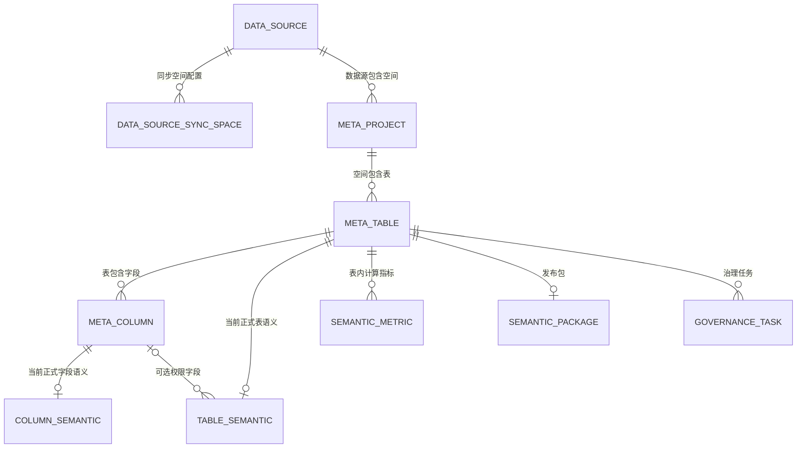
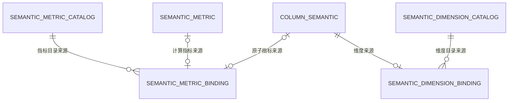

# 资产中心、维度中心与指标中心数据库说明

> 本文说明当前实现，不是新架构方案或数据库迁移脚本。
> 依据：当前仓库 Prisma Schema、元数据同步/治理发布/目录/Package 服务，以及当前项目连接数据库的只读结构核验。
> 核验范围：20 张相关表、227 个实际字段、24 条外键；字段名称及可空性与仓库 Schema 一致。
> 不包含连接地址、数据库账号、密钥、凭证明文或源业务数据。其他部署环境需单独确认迁移是否一致。

## 1. 数据库与分层

三个中心使用同一套 **Atlas PostgreSQL 元数据库**，由 Prisma 管理，连接通过服务端环境变量 `DATABASE_URL` 指定；不是每个中心一个独立数据库。

源业务数据仍位于 MaxCompute 或接入的关系数据库中。资产同步保存的是库/表/字段结构，正式语义保存的是业务定义；这些中心表不复制整张源业务明细表。

| 层次 | 作用 | 主要表 |
| --- | --- | --- |
| 数据源/物理元数据 | 描述数据来自哪里、有哪些表和字段 | data_source、data_source_sync_space、meta_project、meta_table、meta_column |
| 正式语义 | 描述一张表和字段的业务含义、查询规则及计算公式 | table_semantic、column_semantic、semantic_metric |
| 中心目录 | 按业务名称聚合多张表的指标/维度来源，维护别名和说明 | semantic_metric_catalog、semantic_metric_binding、semantic_dimension_catalog、semantic_dimension_binding |
| 语义包 | 将单表元数据、正式语义及目录说明组织为 Agent/API 使用的 Package | semantic_package，以及动态 Package 构建服务 |
| 治理过程 | 保存任务、审核草稿、AI 建议及生成进度 | governance_task、governance_review、ai_*、governance_option |

**核心区别：物理字段不是中心目录，表内正式指标也不是指标中心目录。中心目录通过绑定表找到真实来源。**

## 2. 命名、类型和默认值约定

- 数据表采用 snake_case，例如 `meta_table`；数据库字段保留 camelCase，例如 `metaProjectId`。SQL 中 camelCase 字段需要双引号：`t."metaProjectId"`。
- 字典中的类型按 Prisma Schema 表示，`?` 表示允许 NULL；没有 `?` 表示非空。
- PostgreSQL 中 String 对应 text，Int 对应 integer，Float 对应 double precision，Boolean 对应 boolean，Json 对应 jsonb，DateTime 默认对应 timestamp(3) without time zone。枚举为 PostgreSQL 自定义枚举类型。
- `@default(cuid())` 为 Prisma 生成字符串主键，不是源业务主键，也不要假设直接 SQL INSERT 会由 PostgreSQL 自动生成它。
- `@updatedAt` 由 Prisma 写入更新，不是 PostgreSQL 自动更新时间触发器。
- JSON 中保存的字段 ID、字段名或公式依赖，除非另有关系列，**不会自动形成数据库外键**。
- 下文“Schema 属性”原样展示字段级默认值、主键或唯一属性；复合唯一键、索引和外键另行说明。
- Schema 默认值不一定等于表单/发布服务的归一化默认值。例如 groupable 的数据库默认是 false，但治理保存时会按语义类型及用户选择写入实际开关值。

### 2.1 相关枚举值

| 枚举 | 当前取值与含义 |
| --- | --- |
| `DataSourceType` | `MAXCOMPUTE`、`MYSQL`、`POSTGRESQL`、`SQLSERVER`、`ORACLE`、`MARIADB`、`SQLITE`；表示接入类型，不代表开放查询已支持全部类型 |
| `DataSourceStatus` | `UNTESTED` 未测试、`ACTIVE` 连接测试通过、`FAILED` 连接测试失败 |
| `DataSourceSyncStatus` | `IDLE` 空闲、`RUNNING` 同步中、`SUCCEEDED` 成功、`PARTIAL_FAILED` 部分失败、`FAILED` 失败 |
| `AssetStatus` | `ACTIVE` 有效、`DEPRECATED` 已失效/停用的元数据资产 |
| `StandardDataType` | `STRING`、`INTEGER`、`DECIMAL`、`BOOLEAN`、`DATE`、`DATETIME`、`JSON`、`BINARY`、`UNKNOWN` |
| `ColumnSemanticType` | `METRIC` 原子指标字段、`DIMENSION` 维度、`LABEL` 标签、`PARTITION` 分区语义 |
| `SemanticCatalogStatus` | `PUBLISHED` 已发布目录、`ARCHIVED` 已归档目录 |
| `SemanticMetricCatalogType` | `ATOMIC` 仅原子来源、`DERIVED` 仅计算来源、`MIXED` 同时包含两类来源 |
| `GovernanceTaskStatus` | `PENDING` 待处理、`PROCESSING` 处理中、`REVIEWING` 审核中、`COMPLETED` 已发布完成 |
| `GovernanceOptionType` | `DATA_DOMAIN` 数据域、`PERMISSION_RELATION` 权限映射关系 |
| `AiGenerationStatus` | `RUNNING` 生成中、`COMPLETED` 已完成、`FAILED` 失败、`CANCELLED` 已取消 |
| `AiGenerationStep` | `SAVING_DRAFT` 保存草稿、`PREPARING_CONTEXT` 准备上下文、`CALLING_LLM` 调用模型、`VALIDATING_RESULT` 校验结果、`SAVING_SUGGESTIONS` 保存建议 |

## 3. 关联总览

### 3.1 物理元数据与正式语义



说明：

1. `meta_table` 与 `table_semantic` 是 **1 : 0..1**，未治理/未发布的表没有正式表语义。
2. `meta_column` 与 `column_semantic` 是 **1 : 0..1**，并非所有物理字段都会被选入治理并发布。
3. 一张物理表可以有多个 `semantic_metric`，这些计算指标通常由该表多个字段共同计算。
4. `data_source_sync_space` 和 `meta_project` 均指向数据源，但二者之间没有直接外键。前者用于发现/选择/同步进度，后者用于承载已同步的表结构。
5. 图中的可选权限字段仅表示外键关系；属于同一张表的约束还由发布服务验证。

### 3.2 指标和维度的来源关联



实际追溯路径：

- 原子指标：`semantic_metric_catalog → semantic_metric_binding.columnSemanticId → column_semantic → meta_column → meta_table → meta_project → data_source`。
- 计算指标：`semantic_metric_catalog → semantic_metric_binding.semanticMetricId → semantic_metric → meta_table → meta_project → data_source`。
- 维度：`semantic_dimension_catalog → semantic_dimension_binding → column_semantic → meta_column → meta_table → meta_project → data_source`。
- 绑定表保存的是 **字段语义 ID**，不是物理字段 ID；查询 API 使用的物理字段 ID 需要再通过 `column_semantic.metaColumnId` 找到。

## 4. 资产中心基础表

### `data_source` — 数据源配置

Prisma 模型：`DataSource`。数据源连接与同步状态的根对象。属于三个中心的基础配置；不存放源业务明细。name 全局唯一。

| 字段 | Prisma 类型 | Schema 属性 | 说明 |
| --- | --- | --- | --- |
| `id` | `String` | `@id @default(cuid())` | 本表主键；Prisma 生成的 CUID 字符串，不是源数据库中的业务主键。 |
| `name` | `String` | `@unique` | 数据源名称，全局唯一。 |
| `type` | `DataSourceType` | `@default(MAXCOMPUTE)` | 数据源类型，见 DataSourceType。 |
| `description` | `String?` | — | 数据源说明。 |
| `connectionConfig` | `Json` | `@default("{}")` | 非明文凭证的连接配置 JSON；MaxCompute 保存 region/endpoint/project，关系库保存对应连接参数。 |
| `region` | `String` | `@default("")` | MaxCompute 区域字段；当前写入时也会保存对应 connectionConfig 信息。 |
| `endpoint` | `String` | `@default("")` | MaxCompute 服务地址字段。 |
| `defaultProject` | `String` | `@default("")` | MaxCompute 默认项目字段。 |
| `accessKeyEncrypted` | `String` | `@default("")` | MaxCompute AccessKey 的加密值，不能作为可公开字段输出。 |
| `secretKeyEncrypted` | `String` | `@default("")` | MaxCompute SecretKey 的加密值，不能作为可公开字段输出。 |
| `usernameEncrypted` | `String?` | — | 关系数据库用户名的加密值。 |
| `passwordEncrypted` | `String?` | — | 关系数据库密码的加密值。 |
| `status` | `DataSourceStatus` | `@default(UNTESTED)` | 连接测试状态，见 DataSourceStatus，不是资产是否有效的状态。 |
| `syncStatus` | `DataSourceSyncStatus` | `@default(IDLE)` | 最近一次同步状态，见 DataSourceSyncStatus 枚举。 |
| `syncTotalTables` | `Int` | `@default(0)` | 本轮同步发现的表总数。 |
| `syncProcessedTables` | `Int` | `@default(0)` | 本轮已经处理的表数量，包含成功、跳过和失败的处理进度。 |
| `syncSyncedTables` | `Int` | `@default(0)` | 本轮实际完成元数据同步的表数量。 |
| `syncSkippedTables` | `Int` | `@default(0)` | 本轮因源表更新时间未变化等原因跳过的表数量。 |
| `syncFailedTables` | `Int` | `@default(0)` | 本轮同步失败的数量；空间发现失败时也可能记录失败计数。 |
| `syncError` | `String?` | — | 最近一次同步的错误摘要，不是业务数据。 |
| `syncStartedAt` | `DateTime?` | — | 本轮同步开始时间。 |
| `syncFinishedAt` | `DateTime?` | — | 本轮同步结束时间。 |
| `lastTestedAt` | `DateTime?` | — | 最近一次连接测试时间。 |
| `lastSyncedAt` | `DateTime?` | — | 最近一次同步完成/记录的时间；是否全部成功应结合 syncStatus 判断。 |
| `createdAt` | `DateTime` | `@default(now())` | 本条 Atlas 记录创建时间，不等于源数据的创建时间。 |
| `updatedAt` | `DateTime` | `@updatedAt` | 本条 Atlas 记录通过 Prisma 更新的时间，不等于源表最后变更时间。 |

### `data_source_sync_space` — 数据源同步空间

Prisma 模型：`DataSourceSyncSpace`。记录某数据源下发现/选择的 catalog、schema 以及空间级同步进度。唯一键为 (dataSourceId, catalog, schema)。它和 meta_project 没有直接外键。

| 字段 | Prisma 类型 | Schema 属性 | 说明 |
| --- | --- | --- | --- |
| `id` | `String` | `@id @default(cuid())` | 本表主键；Prisma 生成的 CUID 字符串，不是源数据库中的业务主键。 |
| `dataSourceId` | `String` | — | 所属数据源，外键 → data_source.id。 |
| `catalog` | `String` | `@default("")` | 源系统 catalog/数据库/MaxCompute 项目标识，空字符串表示该层不适用。 |
| `schema` | `String` | `@default("")` | 源系统 schema 标识，空字符串表示该层不适用。 |
| `name` | `String` | — | 空间展示名称。 |
| `description` | `String?` | — | 空间说明。 |
| `selected` | `Boolean` | `@default(false)` | 是否在当前同步选择范围内，不代表当前是否存在资产。 |
| `syncStatus` | `DataSourceSyncStatus` | `@default(IDLE)` | 最近一次同步状态，见 DataSourceSyncStatus 枚举。 |
| `syncTotalTables` | `Int` | `@default(0)` | 本轮同步发现的表总数。 |
| `syncProcessedTables` | `Int` | `@default(0)` | 本轮已经处理的表数量，包含成功、跳过和失败的处理进度。 |
| `syncSyncedTables` | `Int` | `@default(0)` | 本轮实际完成元数据同步的表数量。 |
| `syncSkippedTables` | `Int` | `@default(0)` | 本轮因源表更新时间未变化等原因跳过的表数量。 |
| `syncFailedTables` | `Int` | `@default(0)` | 本轮同步失败的数量；空间发现失败时也可能记录失败计数。 |
| `syncError` | `String?` | — | 最近一次同步的错误摘要，不是业务数据。 |
| `syncStartedAt` | `DateTime?` | — | 本轮同步开始时间。 |
| `syncFinishedAt` | `DateTime?` | — | 本轮同步结束时间。 |
| `lastSyncedAt` | `DateTime?` | — | 最近一次同步完成/记录的时间；是否全部成功应结合 syncStatus 判断。 |
| `createdAt` | `DateTime` | `@default(now())` | 本条 Atlas 记录创建时间，不等于源数据的创建时间。 |
| `updatedAt` | `DateTime` | `@updatedAt` | 本条 Atlas 记录通过 Prisma 更新的时间，不等于源表最后变更时间。 |

### `meta_project` — 已同步的数据空间

Prisma 模型：`MetaProject`。承接已同步元数据的数据空间。MaxCompute 对应项目；关系库按 catalog/schema 组织。唯一键为 (dataSourceId, name)。

| 字段 | Prisma 类型 | Schema 属性 | 说明 |
| --- | --- | --- | --- |
| `id` | `String` | `@id @default(cuid())` | 本表主键；Prisma 生成的 CUID 字符串，不是源数据库中的业务主键。 |
| `dataSourceId` | `String` | — | 所属数据源，外键 → data_source.id。 |
| `name` | `String` | — | 空间名称；同步时由 catalog/schema 的展示规则产生。 |
| `catalog` | `String` | `@default("")` | 源系统 catalog。 |
| `schema` | `String` | `@default("")` | 源系统 schema。 |
| `description` | `String?` | — | 空间说明。 |
| `region` | `String` | — | 同步时记录的区域信息。 |
| `status` | `AssetStatus` | `@default(ACTIVE)` | 空间资产状态：ACTIVE 或 DEPRECATED。 |
| `lastSyncedAt` | `DateTime?` | — | 该空间最近记录的同步时间。 |
| `createdAt` | `DateTime` | `@default(now())` | 本条 Atlas 记录创建时间，不等于源数据的创建时间。 |
| `updatedAt` | `DateTime` | `@updatedAt` | 本条 Atlas 记录通过 Prisma 更新的时间，不等于源表最后变更时间。 |

### `meta_table` — 物理表资产

Prisma 模型：`MetaTable`。资产中心列表的主表。唯一键为 (metaProjectId, name)。这里只保存表结构元数据；表的业务名称和描述来自 table_semantic。

| 字段 | Prisma 类型 | Schema 属性 | 说明 |
| --- | --- | --- | --- |
| `id` | `String` | `@id @default(cuid())` | 本表主键；Prisma 生成的 CUID 字符串，不是源数据库中的业务主键。 |
| `metaProjectId` | `String` | — | 所属数据空间，外键 → meta_project.id。 |
| `name` | `String` | — | 源系统物理表名，不是治理后的业务名称。 |
| `type` | `String` | — | 源适配器返回的表/视图类型字符串，不是 Prisma 枚举。 |
| `comment` | `String?` | — | 源系统中的表注释。 |
| `sourceUpdatedAt` | `DateTime?` | — | 源系统提供的表更新时间，可能为空。 |
| `status` | `AssetStatus` | `@default(ACTIVE)` | 物理表有效状态：ACTIVE 或 DEPRECATED。 |
| `lastSyncedAt` | `DateTime?` | — | 该表最近一次结构同步时间。 |
| `createdAt` | `DateTime` | `@default(now())` | 本条 Atlas 记录创建时间，不等于源数据的创建时间。 |
| `updatedAt` | `DateTime` | `@updatedAt` | 本条 Atlas 记录通过 Prisma 更新的时间，不等于源表最后变更时间。 |

### `meta_column` — 物理字段资产

Prisma 模型：`MetaColumn`。源表的物理字段定义。唯一键为 (metaTableId, name)。本表 id 是 Package fields[].id 及大多数查询字段参数使用的 ID。

| 字段 | Prisma 类型 | Schema 属性 | 说明 |
| --- | --- | --- | --- |
| `id` | `String` | `@id @default(cuid())` | 本表主键；Prisma 生成的 CUID 字符串，不是源数据库中的业务主键。 |
| `metaTableId` | `String` | — | 所属物理表，外键 → meta_table.id。 |
| `name` | `String` | — | 物理字段名。 |
| `dataType` | `String` | — | 源系统原始数据类型，如 STRING、BIGINT、DECIMAL 等。 |
| `normalizedType` | `StandardDataType` | `@default(UNKNOWN)` | 跨数据源归一化类型，见 StandardDataType。 |
| `comment` | `String?` | — | 源系统中的字段注释。 |
| `ordinal` | `Int` | — | 同步记录的字段排列顺序；当前同步服务使用从 0 开始的下标。 |
| `isNullable` | `Boolean?` | — | 源字段是否允许 NULL；未知时为 NULL。 |
| `defaultValue` | `String?` | — | 源字段默认值的文本表示，不是本表字段的默认值。 |
| `isPrimaryKey` | `Boolean` | `@default(false)` | 该源字段是否为业务源表的主键列；与 meta_column.id 的主键概念不同。 |
| `isPartition` | `Boolean` | `@default(false)` | 是否为源系统物理分区字段。 |
| `length` | `Int?` | — | 源字段长度，如字符串长度；未知或不适用时为 NULL。 |
| `precision` | `Int?` | — | 源数值字段总精度；未知或不适用时为 NULL。 |
| `scale` | `Int?` | — | 源数值字段小数位数；未知或不适用时为 NULL。 |
| `status` | `AssetStatus` | `@default(ACTIVE)` | 字段资产状态：ACTIVE 或 DEPRECATED。 |
| `createdAt` | `DateTime` | `@default(now())` | 本条 Atlas 记录创建时间，不等于源数据的创建时间。 |
| `updatedAt` | `DateTime` | `@updatedAt` | 本条 Atlas 记录通过 Prisma 更新的时间，不等于源表最后变更时间。 |

## 5. 正式语义与语义包

### `table_semantic` — 已发布表语义

Prisma 模型：`TableSemantic`。一张物理表最多一条当前正式表语义，metaTableId 唯一。重复发布更新此行，不是追加一套历史版本。

| 字段 | Prisma 类型 | Schema 属性 | 说明 |
| --- | --- | --- | --- |
| `id` | `String` | `@id @default(cuid())` | 本表主键；Prisma 生成的 CUID 字符串，不是源数据库中的业务主键。 |
| `metaTableId` | `String` | `@unique` | 对应物理表，唯一外键 → meta_table.id。 |
| `sourceGovernanceTaskId` | `String` | — | 本次正式语义来源任务，外键 → governance_task.id。 |
| `dataDomain` | `String?` | — | 业务数据域名称；保存文本，不是 governance_option 的外键。 |
| `businessName` | `String` | — | 治理后的业务表名，供资产列表、搜索和 Package 展示。 |
| `description` | `String` | — | 治理后的业务描述，不覆盖 meta_table.comment。 |
| `grain` | `String` | — | 粒度字段的物理列名，数据库中为逗号分隔字符串；Package 转为字符串数组。 |
| `permissionColumnId` | `String?` | — | 可选权限字段，外键 → meta_column.id；发布服务验证其属于当前表的已选字段。 |
| `permissionRelation` | `String?` | — | 权限映射关系名称/配置文本；不属于用户/角色外键。 |
| `queryConfig` | `Json` | `@default("{}")` | 默认统计日期与存储方式配置 JSON，详见本文 JSON 结构说明。 |
| `publishedBy` | `String` | — | 发布者的 Haze member_no 文本，没有关联本地用户表的外键。 |
| `publishedByName` | `String?` | — | 发布时保存的姓名快照；资产中心“更新人”的来源。 |
| `publishedAt` | `DateTime` | `@default(now())` | 最近一次发布写入的发布时间；每次重新发布会更新。 |
| `updatedAt` | `DateTime` | `@updatedAt` | 本条 Atlas 记录通过 Prisma 更新的时间，不等于源表最后变更时间。 |

### `column_semantic` — 已发布字段语义

Prisma 模型：`ColumnSemantic`。一个物理字段最多一条当前正式语义，metaColumnId 唯一。metricName 同时用于指标、维度、标签和分区，不只用于指标。

| 字段 | Prisma 类型 | Schema 属性 | 说明 |
| --- | --- | --- | --- |
| `id` | `String` | `@id @default(cuid())` | 本表主键；Prisma 生成的 CUID 字符串，不是源数据库中的业务主键。 |
| `metaColumnId` | `String` | `@unique` | 对应物理字段，唯一外键 → meta_column.id。 |
| `sourceGovernanceTaskId` | `String` | — | 来源治理任务，外键 → governance_task.id。 |
| `metricName` | `String` | — | 字段的业务名称；字段名虽为 metricName，但适用于全部语义类型。 |
| `semanticType` | `ColumnSemanticType` | — | 字段语义类型：METRIC、DIMENSION、LABEL 或 PARTITION。 |
| `aggregation` | `String?` | — | 原子指标聚合方式，如 SUM、AVG、COUNT、COUNT_DISTINCT、MIN、MAX；非指标发布时清空。 |
| `unit` | `String?` | — | 原子指标单位；非指标发布时清空。 |
| `groupable` | `Boolean` | `@default(false)` | 是否允许分组；仅 DIMENSION/LABEL/PARTITION 可以开启。 |
| `candidateValueQueryable` | `Boolean` | `@default(false)` | 是否允许查询真实候选值；仅 DIMENSION/LABEL 可以开启，分区不支持。 |
| `labelDescription` | `String?` | — | 标签说明；仅 LABEL 类型保留。 |
| `publishedBy` | `String` | — | 发布者 Haze member_no 文本。 |
| `publishedAt` | `DateTime` | `@default(now())` | 最近一次字段语义发布时间。 |
| `updatedAt` | `DateTime` | `@updatedAt` | 本条 Atlas 记录通过 Prisma 更新的时间，不等于源表最后变更时间。 |

### `semantic_metric` — 已发布计算指标

Prisma 模型：`SemanticMetric`。保存表内计算指标/派生指标，不是指标中心目录。唯一键为 (metaTableId, name)。其公式和依赖属于当前单表。

| 字段 | Prisma 类型 | Schema 属性 | 说明 |
| --- | --- | --- | --- |
| `id` | `String` | `@id @default(cuid())` | 本表主键；Prisma 生成的 CUID 字符串，不是源数据库中的业务主键。 |
| `metaTableId` | `String` | — | 所属物理表，外键 → meta_table.id。 |
| `sourceGovernanceTaskId` | `String` | — | 来源治理任务，外键 → governance_task.id。 |
| `name` | `String` | — | 计算指标业务名称。 |
| `formula` | `String` | — | 经公式解析校验后保存的聚合表达式，使用物理字段，不是任意 SQL。 |
| `unit` | `String?` | — | 计算结果单位。 |
| `dependencies` | `Json` | — | 公式依赖 JSON 数组，元素包含 meta_column_id 和 column；是应用校验的引用，不是逐项数据库外键。 |
| `publishedBy` | `String` | — | 发布者 Haze member_no 文本。 |
| `publishedAt` | `DateTime` | `@default(now())` | 最近一次计算指标发布时间。 |
| `updatedAt` | `DateTime` | `@updatedAt` | 本条 Atlas 记录通过 Prisma 更新的时间，不等于源表最后变更时间。 |

### `semantic_package` — 发布时保存的语义包

Prisma 模型：`SemanticPackage`。metaTableId 唯一，一张表最多一条保存的 Package JSON。发布事务会更新它；当前读取 Package 的服务会从最新关系数据重建，并非直接返回此 JSON。

| 字段 | Prisma 类型 | Schema 属性 | 说明 |
| --- | --- | --- | --- |
| `id` | `String` | `@id @default(cuid())` | 本表主键；Prisma 生成的 CUID 字符串，不是源数据库中的业务主键。 |
| `metaTableId` | `String` | `@unique` | 对应物理表，唯一外键 → meta_table.id。 |
| `content` | `Json` | — | 发布时构建的完整语义包 JSON，包含 source/table/fields/metrics/completeness 和内容版本；不包含明文连接凭证或业务结果行。 |
| `createdAt` | `DateTime` | `@default(now())` | 本条 Atlas 记录创建时间，不等于源数据的创建时间。 |
| `updatedAt` | `DateTime` | `@updatedAt` | 本条 Atlas 记录通过 Prisma 更新的时间，不等于源表最后变更时间。 |

## 6. 指标中心

### `semantic_metric_catalog` — 指标中心目录

Prisma 模型：`SemanticMetricCatalog`。指标中心列表和详情的主表。normalizedName 在整个指标目录内唯一，不按数据源、数据域、公式或单位分组建唯一键。

| 字段 | Prisma 类型 | Schema 属性 | 说明 |
| --- | --- | --- | --- |
| `id` | `String` | `@id @default(cuid())` | 本表主键；Prisma 生成的 CUID 字符串，不是源数据库中的业务主键。 |
| `normalizedName` | `String` | `@unique` | 指标名称 trim().toLowerCase() 的结果，用于全局同名聚合；不是根据 aliases 计算。 |
| `name` | `String` | — | 中心展示名称，由发布来源的指标名称同步。 |
| `description` | `String` | `@default("")` | 目录级业务说明；不等于某一来源字段注释或公式。 |
| `type` | `SemanticMetricCatalogType` | `@default(ATOMIC)` | 由绑定来源计算：ATOMIC、DERIVED 或 MIXED。 |
| `unit` | `String?` | — | 由所有来源单位汇总；单一单位保留，多种单位显示“多单位”，不进行单位换算。 |
| `aliases` | `Json` | `@default("[]")` | 目录别名 JSON 字符串数组；支持名称之外的业务检索。 |
| `dataSource` | `String` | `@default("")` | 人工维护的数据来源说明文本；不是 data_source.id，也不是外键。 |
| `editedAt` | `DateTime?` | — | 维护接口最近保存时间；非空时界面 editStatus 为 EDITED。 |
| `category` | `String?` | — | 人工维护的分类文本，不关联分类表。 |
| `owner` | `String?` | — | 人工维护的负责人文本，不是 Haze 用户外键。 |
| `usageNotes` | `String?` | — | 人工维护的使用说明。 |
| `status` | `SemanticCatalogStatus` | `@default(PUBLISHED)` | 目录状态：PUBLISHED 或 ARCHIVED；来源重新绑定时重新计算。 |
| `createdAt` | `DateTime` | `@default(now())` | 本条 Atlas 记录创建时间，不等于源数据的创建时间。 |
| `updatedAt` | `DateTime` | `@updatedAt` | 本条 Atlas 记录通过 Prisma 更新的时间，不等于源表最后变更时间。 |

### `semantic_metric_binding` — 指标目录来源绑定

Prisma 模型：`SemanticMetricBinding`。将目录项连接到原子指标字段或计算指标。columnSemanticId、semanticMetricId 各自唯一且允许空；发布服务正常写入时二选一。当前数据库没有 CHECK 强制两者互斥。

| 字段 | Prisma 类型 | Schema 属性 | 说明 |
| --- | --- | --- | --- |
| `id` | `String` | `@id @default(cuid())` | 本表主键；Prisma 生成的 CUID 字符串，不是源数据库中的业务主键。 |
| `metricCatalogId` | `String` | — | 所属指标目录，外键 → semantic_metric_catalog.id。 |
| `columnSemanticId` | `String?` | `@unique` | 原子指标来源，唯一可空外键 → column_semantic.id；注意不是 meta_column.id。 |
| `semanticMetricId` | `String?` | `@unique` | 计算指标来源，唯一可空外键 → semantic_metric.id。 |
| `createdAt` | `DateTime` | `@default(now())` | 本条 Atlas 记录创建时间，不等于源数据的创建时间。 |

## 7. 维度中心

### `semantic_dimension_catalog` — 维度中心目录

Prisma 模型：`SemanticDimensionCatalog`。维度中心列表和详情的主表。normalizedName 在整个维度目录内唯一；与指标目录是两套独立命名空间。

| 字段 | Prisma 类型 | Schema 属性 | 说明 |
| --- | --- | --- | --- |
| `id` | `String` | `@id @default(cuid())` | 本表主键；Prisma 生成的 CUID 字符串，不是源数据库中的业务主键。 |
| `normalizedName` | `String` | `@unique` | 维度名称 trim().toLowerCase() 的结果，用于全局同名聚合。 |
| `name` | `String` | — | 中心展示名称，由 DIMENSION 字段业务名称同步。 |
| `description` | `String` | `@default("")` | 维度目录级业务说明。 |
| `aliases` | `Json` | `@default("[]")` | 目录别名 JSON 字符串数组。 |
| `dataSource` | `String` | `@default("")` | 人工维护的数据来源说明文本；不是 data_source.id 外键。 |
| `editedAt` | `DateTime?` | — | 维护接口最近保存时间；非空时界面 editStatus 为 EDITED。 |
| `category` | `String?` | — | 维度分类文本。 |
| `owner` | `String?` | — | 负责人文本，不是用户外键。 |
| `usageNotes` | `String?` | — | 维度使用说明。 |
| `status` | `SemanticCatalogStatus` | `@default(PUBLISHED)` | PUBLISHED 或 ARCHIVED，由来源绑定情况刷新。 |
| `createdAt` | `DateTime` | `@default(now())` | 本条 Atlas 记录创建时间，不等于源数据的创建时间。 |
| `updatedAt` | `DateTime` | `@updatedAt` | 本条 Atlas 记录通过 Prisma 更新的时间，不等于源表最后变更时间。 |

### `semantic_dimension_binding` — 维度目录来源绑定

Prisma 模型：`SemanticDimensionBinding`。将目录项连接到一个正式 DIMENSION 字段。columnSemanticId 非空且唯一；一个来源字段最多绑定一个维度目录。

| 字段 | Prisma 类型 | Schema 属性 | 说明 |
| --- | --- | --- | --- |
| `id` | `String` | `@id @default(cuid())` | 本表主键；Prisma 生成的 CUID 字符串，不是源数据库中的业务主键。 |
| `dimensionCatalogId` | `String` | — | 所属维度目录，外键 → semantic_dimension_catalog.id。 |
| `columnSemanticId` | `String` | `@unique` | 来源字段语义，唯一外键 → column_semantic.id，不是物理字段 ID。 |
| `createdAt` | `DateTime` | `@default(now())` | 本条 Atlas 记录创建时间，不等于源数据的创建时间。 |

## 8. 治理流程辅助表

### `governance_task` — 治理任务

Prisma 模型：`GovernanceTask`。连接物理表、草稿、AI 建议和正式发布来源。一张表可以有多个任务。任务状态和资产列表的治理展示状态不是同一个持久化字段。

| 字段 | Prisma 类型 | Schema 属性 | 说明 |
| --- | --- | --- | --- |
| `id` | `String` | `@id @default(cuid())` | 本表主键；Prisma 生成的 CUID 字符串，不是源数据库中的业务主键。 |
| `metaTableId` | `String` | — | 本任务治理的物理表，外键 → meta_table.id。 |
| `selectedColumns` | `Json` | — | 已选 meta_column.id 的 JSON 数组；不是逐项数据库外键，服务验证归属/有效性。 |
| `status` | `GovernanceTaskStatus` | `@default(PENDING)` | 任务状态：PENDING、PROCESSING、REVIEWING、COMPLETED。 |
| `createdBy` | `String` | — | 创建人文本字段；当前任务创建服务仍写 local-user，不能把它解释为已核实的 Haze 创建者身份。 |
| `createdAt` | `DateTime` | `@default(now())` | 本条 Atlas 记录创建时间，不等于源数据的创建时间。 |
| `updatedAt` | `DateTime` | `@updatedAt` | 本条 Atlas 记录通过 Prisma 更新的时间，不等于源表最后变更时间。 |

### `governance_option` — 治理选项字典

Prisma 模型：`GovernanceOption`。提供数据域和权限映射关系候选项。唯一键为 (type, value)；正式表语义保存其文本值，不建立外键。

| 字段 | Prisma 类型 | Schema 属性 | 说明 |
| --- | --- | --- | --- |
| `id` | `String` | `@id @default(cuid())` | 本表主键；Prisma 生成的 CUID 字符串，不是源数据库中的业务主键。 |
| `type` | `GovernanceOptionType` | — | 选项类别：DATA_DOMAIN 或 PERMISSION_RELATION。 |
| `value` | `String` | — | 选项显示值。 |
| `description` | `String` | `@default("")` | 选项说明。 |
| `updatedBy` | `String` | `@default("admin")` | 选项维护者文本，Schema 默认 admin，不是用户外键。 |
| `createdAt` | `DateTime` | `@default(now())` | 本条 Atlas 记录创建时间，不等于源数据的创建时间。 |
| `updatedAt` | `DateTime` | `@updatedAt` | 本条 Atlas 记录通过 Prisma 更新的时间，不等于源表最后变更时间。 |

### `governance_review` — 人工审核草稿

Prisma 模型：`GovernanceReview`。governanceTaskId 唯一，每个任务最多一条当前草稿。保存/审核不等于发布；草稿内容不会自动成为中心目录来源。

| 字段 | Prisma 类型 | Schema 属性 | 说明 |
| --- | --- | --- | --- |
| `id` | `String` | `@id @default(cuid())` | 本表主键；Prisma 生成的 CUID 字符串，不是源数据库中的业务主键。 |
| `governanceTaskId` | `String` | `@unique` | 所属治理任务，唯一外键 → governance_task.id。 |
| `tableDraft` | `Json` | — | 表级草稿 JSON，含业务名称、说明、粒度、权限及 queryConfig 等。 |
| `columnDrafts` | `Json` | — | 已选字段的语义草稿 JSON 数组。 |
| `metricDrafts` | `Json` | `@default("[]")` | 计算指标草稿 JSON 数组，默认 []。 |
| `createdAt` | `DateTime` | `@default(now())` | 本条 Atlas 记录创建时间，不等于源数据的创建时间。 |
| `updatedAt` | `DateTime` | `@updatedAt` | 本条 Atlas 记录通过 Prisma 更新的时间，不等于源表最后变更时间。 |

### `ai_table_suggestion` — AI 表级建议

Prisma 模型：`AiTableSuggestion`。governanceTaskId 唯一；AI 建议是临时治理辅助，不是正式表语义。

| 字段 | Prisma 类型 | Schema 属性 | 说明 |
| --- | --- | --- | --- |
| `id` | `String` | `@id @default(cuid())` | 本表主键；Prisma 生成的 CUID 字符串，不是源数据库中的业务主键。 |
| `governanceTaskId` | `String` | `@unique` | 所属任务，唯一外键 → governance_task.id。 |
| `dataDomain` | `String?` | — | AI 建议的数据域文本。 |
| `businessName` | `String` | — | AI 建议的业务表名。 |
| `description` | `String` | — | AI 建议的业务描述。 |
| `grain` | `String?` | — | AI 建议的粒度文本，后续保存/发布还会校验。 |
| `permissionColumnId` | `String?` | — | AI 建议的物理字段 ID 文本，没有数据库外键。 |
| `permissionRelation` | `String?` | — | AI 建议的权限映射关系。 |
| `queryConfig` | `Json` | `@default("{}")` | AI 建议的默认日期/存储方式 JSON。 |
| `createdAt` | `DateTime` | `@default(now())` | 本条 Atlas 记录创建时间，不等于源数据的创建时间。 |
| `updatedAt` | `DateTime` | `@updatedAt` | 本条 Atlas 记录通过 Prisma 更新的时间，不等于源表最后变更时间。 |

### `ai_column_suggestion` — AI 字段级建议

Prisma 模型：`AiColumnSuggestion`。唯一键为 (governanceTaskId, metaColumnId)。一个字段可以在不同任务下有不同建议。

| 字段 | Prisma 类型 | Schema 属性 | 说明 |
| --- | --- | --- | --- |
| `id` | `String` | `@id @default(cuid())` | 本表主键；Prisma 生成的 CUID 字符串，不是源数据库中的业务主键。 |
| `governanceTaskId` | `String` | — | 所属治理任务，外键 → governance_task.id。 |
| `metaColumnId` | `String` | — | 目标物理字段，外键 → meta_column.id。 |
| `metricName` | `String` | — | AI 建议的字段业务名称。 |
| `semanticType` | `String` | — | AI 建议的语义类型文本；这里是 String，不是 ColumnSemanticType 枚举列。 |
| `aggregation` | `String?` | — | AI 建议的聚合方式。 |
| `unit` | `String?` | — | AI 建议的单位。 |
| `groupable` | `Boolean` | `@default(false)` | AI 建议是否允许分组；最终受保存/发布规则约束。 |
| `candidateValueQueryable` | `Boolean` | `@default(false)` | AI 建议是否允许候选值查询；最终受字段类型规则约束。 |
| `labelDescription` | `String?` | — | AI 建议的标签说明。 |
| `confidence` | `Float` | — | AI 提供的置信度数值，不是数据库约束保障的正确性。 |
| `reason` | `String` | — | AI 建议依据或理由。 |
| `createdAt` | `DateTime` | `@default(now())` | 本条 Atlas 记录创建时间，不等于源数据的创建时间。 |
| `updatedAt` | `DateTime` | `@updatedAt` | 本条 Atlas 记录通过 Prisma 更新的时间，不等于源表最后变更时间。 |

### `ai_metric_suggestion` — AI 计算指标建议

Prisma 模型：`AiMetricSuggestion`。唯一键为 (governanceTaskId, name)。只有经过审核发布后才写入 semantic_metric。

| 字段 | Prisma 类型 | Schema 属性 | 说明 |
| --- | --- | --- | --- |
| `id` | `String` | `@id @default(cuid())` | 本表主键；Prisma 生成的 CUID 字符串，不是源数据库中的业务主键。 |
| `governanceTaskId` | `String` | — | 所属治理任务，外键 → governance_task.id。 |
| `name` | `String` | — | 建议的计算指标名称。 |
| `formula` | `String` | — | 建议公式文本，发布前仍需解析校验。 |
| `unit` | `String?` | — | 建议单位。 |
| `dependencies` | `Json` | — | 建议的依赖 JSON；不是逐项数据库外键。 |
| `confidence` | `Float` | — | 建议置信度。 |
| `reason` | `String` | — | 建议依据或理由。 |
| `createdAt` | `DateTime` | `@default(now())` | 本条 Atlas 记录创建时间，不等于源数据的创建时间。 |
| `updatedAt` | `DateTime` | `@updatedAt` | 本条 Atlas 记录通过 Prisma 更新的时间，不等于源表最后变更时间。 |

### `ai_generation` — AI 生成执行状态

Prisma 模型：`AiGeneration`。记录某治理任务的一次 AI 生成过程；同一个任务可多次生成。它本身不存正式指标/维度定义。

| 字段 | Prisma 类型 | Schema 属性 | 说明 |
| --- | --- | --- | --- |
| `id` | `String` | `@id @default(cuid())` | 本表主键；Prisma 生成的 CUID 字符串，不是源数据库中的业务主键。 |
| `governanceTaskId` | `String` | — | 所属治理任务，外键 → governance_task.id。 |
| `status` | `AiGenerationStatus` | `@default(RUNNING)` | RUNNING、COMPLETED、FAILED、CANCELLED。 |
| `step` | `AiGenerationStep` | `@default(SAVING_DRAFT)` | 执行步骤：SAVING_DRAFT、PREPARING_CONTEXT、CALLING_LLM、VALIDATING_RESULT、SAVING_SUGGESTIONS。 |
| `message` | `String` | — | 当前步骤的可读说明。 |
| `error` | `String?` | — | 生成失败的错误说明。 |
| `previousTaskStatus` | `GovernanceTaskStatus` | — | 开始生成前的治理任务状态。 |
| `startedAt` | `DateTime` | `@default(now())` | 本轮生成开始时间，默认 now()。 |
| `completedAt` | `DateTime?` | — | 完成、失败或取消的结束时间。 |

## 9. 重要 JSON 字段与业务规则

### 9.1 表级查询配置：table_semantic.queryConfig

```json
{
  "default_stat_date": {
    "field_id": "当前表的 meta_column.id",
    "format": "yyyyMMdd"
  },
  "storage": "DATE_INCREMENTAL"
}
```

- `field_id` 是物理字段 ID，不是字段名称或 `column_semantic.id`；无默认日期时为 null，format 为空字符串。
- `storage` 为 DATE_INCREMENTAL、FULL_SNAPSHOT 或 null；当前仅物理分区表允许选择前两种存储方式。
- 日期增量模式的指标/候选值查询需要日期范围；全量快照模式由执行服务选择最新快照，不由调用者填写默认日期区间。
- 这些 ID 保存在 JSON 内，没有数据库外键；保存、发布及 Package 构建会校验它们。
- `permissionColumnId` 是选填项；填写时需要同时填写 `permissionRelation`。**当前查询编译器没有使用这两个字段自动生成按用户过滤条件，不能把它们当作已实现的行级权限系统。**

### 9.2 计算指标依赖：semantic_metric.dependencies

```json
[
  {
    "meta_column_id": "当前表的 meta_column.id",
    "column": "物理字段名"
  }
]
```

- 正式公式由公式解析服务校验并解析依赖；引用的是当前表的物理字段，不建立跨表 JOIN。
- JSON 数组中的依赖不是数据库外键。Package 构建会检查依赖是否仍为有效字段，对失效依赖报告问题并排除相应计算指标。
- Package 对外将依赖映射为 `{ id, column }`，因此数据库 JSON 字段名和对外协议字段名并不完全相同。

### 9.3 目录别名：aliases

```json
["销售额", "GMV", "成交金额"]
```

- 位于两个中心的 catalog 表，不单独建立 alias 子表。
- 维护时去除空字符串并去重；目录列表检索同时匹配名称、说明和别名，别名支持不区分大小写的部分匹配。
- 归并目录使用 normalizedName，**不是**按别名合并；相同别名可以出现在不同目录项中。

### 9.4 发布语义包：semantic_package.content

主要结构为 `schema_version、content_version、updated_at、source、table、fields、metrics、completeness`。

| 包内字段 | 数据来源/意义 |
| --- | --- |
| source | data_source + meta_project 的非凭证来源信息 |
| table | meta_table + table_semantic |
| fields | 有正式 column_semantic 的 ACTIVE meta_column，包含指标/维度/标签/分区 |
| fields[].catalog | 对应中心的已发布 catalog 说明、别名及使用说明；标签/分区没有中心绑定 |
| metrics | semantic_metric 中依赖有效的表内计算指标 |
| completeness | 默认日期、粒度、目录绑定及计算依赖等完整性检查结果，不是数据库列 |
| content_version | 对实际包内容做规范化后计算的 SHA-256，不是数据库行 ID，也不是发布次数 |

发布时会保存 content；**当前 PackageService.get 读取时以最新关系表重新构建**。修改中心别名、说明等即使没有再次发布表，也可能改变实际返回的 content_version；保存的发布包不一定等于此刻动态返回的包。

## 10. 数据如何流入三个中心

### 10.1 元数据同步

1. 配置 data_source，发现/选择 data_source_sync_space。
2. 同步写入 meta_project → meta_table → meta_column。
3. 已不存在的表或字段通常标记 DEPRECATED，而不是立即物理删除；有效项同步为 ACTIVE。
4. 同步并不自动把源字段变成正式指标/维度，仍需治理发布。

### 10.2 治理、审核与发布

1. 创建 governance_task，并保存 selectedColumns。
2. AI 生成过程写入 ai_generation、ai_table_suggestion、ai_column_suggestion、ai_metric_suggestion；人工审核草稿保存在 governance_review。
3. 发布服务校验草稿、字段归属、公式、默认日期及可选权限映射。
4. 在同一事务中 upsert table_semantic、column_semantic、semantic_metric；清除本次不再发布的字段语义/计算指标。
5. 重建当前表的中心绑定，刷新受影响目录类型、单位与状态。
6. 生成 semantic_package，最后将本次 governance_task 标为 COMPLETED。

### 10.3 中心目录归并与维护

- 指标中心：只收集 METRIC 字段及 semantic_metric 计算指标。
- 维度中心：只收集 DIMENSION 字段；**LABEL、PARTITION 不自动进入维度中心**，但符合开关规则时仍可参与查询分组/候选值等能力。
- 目录按 trim().toLowerCase() 后的名称全局归并，跨表、跨数据源的同名业务项可能汇总到同一目录。
- ATOMIC 表示只有原子来源；DERIVED 表示只有计算来源；MIXED 表示同时存在两种来源。MIXED 不是第三类计算公式。
- 同名归并不意味着公式、口径、单位完全一致。指标目录出现“多单位”仅提示来源单位不一致，不会换算。
- 最后一个绑定消失后目录转为 ARCHIVED，而不是直接删除；重新绑定后可变为 PUBLISHED。
- 维护接口允许修改 description、aliases、dataSource、category、owner、usageNotes，并设置 editedAt；不允许直接修改来源公式、聚合方式或物理字段。
- 中心说明/别名维护不会反写源表注释，也不会修改表内正式公式；动态 Package 会读取相关目录说明。

## 11. 界面展示字段与数据库字段的对应

| 页面/字段 | 实际来源 | 注意事项 |
| --- | --- | --- |
| 资产列表的物理表名/表类型 | meta_table.name/type | 源结构信息 |
| 资产列表的业务名称/业务描述 | table_semantic.businessName/description | 未发布时可为空 |
| 资产列表的数据空间 | meta_project.name | 不等于目录中的 dataSource 文本 |
| 资产列表的更新时间 | 优先 meta_table.sourceUpdatedAt，否则 meta_table.updatedAt | 不等于最后语义发布时间 |
| 资产列表的更新人 | table_semantic.publishedByName | 是发布者姓名快照，不是同步服务操作者 |
| 资产列表的 governanceStatus | 服务层动态计算 | 有 table_semantic 为 COMPLETED；否则有未完成任务为 DRAFT；否则为 UNGOVERNED；不是 meta_table 的数据库列 |
| 资产列表的 hasPackage | semantic_package 是否存在 | 不是已通过全部可查询检查的标志 |
| 指标/维度中心的 sourceCount | 绑定记录数量 | 不是 COUNT(DISTINCT table_id)，同表多个来源可能多次计数 |
| 指标/维度中心的 editStatus | editedAt 是否非空 | 不是独立数据库列，也不按 updatedAt 判断 |
| 中心的“数据来源” | catalog.dataSource | 人工维护文本，不是 data_source 外键 |
| 维度中心的字段类型 | 来源 meta_column.dataType | 每个来源可以不同，不保存在维度 catalog 主表 |
| 指标中心的公式/聚合方式 | semantic_metric.formula 或 column_semantic.aggregation | 分别在各来源上，不是目录主表统一定义 |

范围差异：资产列表过滤 ACTIVE 表和 ACTIVE 空间；可查询表列表还要求已发布表语义且至少有一个有效已发布字段，但不保证完整性一定 COMPLETE，也不代表所有数据源都支持执行。当前执行仅支持 MaxCompute。两个中心列表主要按 catalog.status=PUBLISHED 过滤，sourceCount 是绑定数；元数据标记 DEPRECATED 不会自动重建目录绑定，因此中心展示不能替代执行前的有效性检查。

## 12. 数据库外键、索引与删除行为

### 12.1 外键

以下是当前相关 20 张表的全部 24 条外键。Cascade 指数据库**物理 DELETE**的级联行为，不等于标记 DEPRECATED 时会级联删除。

| 子表 | 外键列 | 父表.主键 | 父记录删除时 |
| --- | --- | --- | --- |
| `ai_column_suggestion` | `governanceTaskId` | `governance_task.id` | CASCADE |
| `ai_column_suggestion` | `metaColumnId` | `meta_column.id` | CASCADE |
| `ai_generation` | `governanceTaskId` | `governance_task.id` | CASCADE |
| `ai_metric_suggestion` | `governanceTaskId` | `governance_task.id` | CASCADE |
| `ai_table_suggestion` | `governanceTaskId` | `governance_task.id` | CASCADE |
| `column_semantic` | `metaColumnId` | `meta_column.id` | CASCADE |
| `column_semantic` | `sourceGovernanceTaskId` | `governance_task.id` | RESTRICT |
| `data_source_sync_space` | `dataSourceId` | `data_source.id` | CASCADE |
| `governance_review` | `governanceTaskId` | `governance_task.id` | CASCADE |
| `governance_task` | `metaTableId` | `meta_table.id` | CASCADE |
| `meta_column` | `metaTableId` | `meta_table.id` | CASCADE |
| `meta_project` | `dataSourceId` | `data_source.id` | CASCADE |
| `meta_table` | `metaProjectId` | `meta_project.id` | CASCADE |
| `semantic_dimension_binding` | `columnSemanticId` | `column_semantic.id` | CASCADE |
| `semantic_dimension_binding` | `dimensionCatalogId` | `semantic_dimension_catalog.id` | CASCADE |
| `semantic_metric` | `metaTableId` | `meta_table.id` | CASCADE |
| `semantic_metric` | `sourceGovernanceTaskId` | `governance_task.id` | RESTRICT |
| `semantic_metric_binding` | `columnSemanticId` | `column_semantic.id` | CASCADE |
| `semantic_metric_binding` | `metricCatalogId` | `semantic_metric_catalog.id` | CASCADE |
| `semantic_metric_binding` | `semanticMetricId` | `semantic_metric.id` | CASCADE |
| `semantic_package` | `metaTableId` | `meta_table.id` | CASCADE |
| `table_semantic` | `metaTableId` | `meta_table.id` | CASCADE |
| `table_semantic` | `permissionColumnId` | `meta_column.id` | SET NULL |
| `table_semantic` | `sourceGovernanceTaskId` | `governance_task.id` | RESTRICT |

重要边界：

- 三种正式语义的 sourceGovernanceTaskId 均为 RESTRICT，存在发布引用时不能直接删除相应治理任务。
- 删除权限物理字段时，table_semantic.permissionColumnId 置 NULL；permissionRelation 是普通文本列，数据库不会同步清空它。
- 两个 catalog 的 normalizedName 均唯一；两个绑定表的来源语义 ID 也唯一。
- semantic_metric_binding 的两个来源外键均可空。当前数据库没有 CHECK 约束强制“恰好一个非空”，二选一由发布服务正常写入保证。
- dataDomain、permissionRelation、owner、publishedBy、createdBy、selectedColumns、dependencies 等文本/JSON 引用，不要误认为都有外键或跨表一致性约束。
- 不能把 Prisma 的关系属性（例如 columns、bindings、semantic）当成数据库中真实存在的列；字段字典只列实际标量列。

### 12.2 索引与唯一约束速查

当前核验数据库中这 20 张表共有 **55 个索引**，包括主键索引和唯一索引。下表中每一项计为一个索引；字段顺序按实际索引定义列出。`PK` 为主键索引，`UQ` 为唯一索引，`IDX` 为普通索引。

| 表 | 当前索引 |
| --- | --- |
| `data_source` | PK(id)；UQ(name) |
| `data_source_sync_space` | PK(id)；UQ(dataSourceId, catalog, schema)；IDX(dataSourceId, selected) |
| `meta_project` | PK(id)；UQ(dataSourceId, name) |
| `meta_table` | PK(id)；UQ(metaProjectId, name) |
| `meta_column` | PK(id)；UQ(metaTableId, name) |
| `table_semantic` | PK(id)；UQ(metaTableId)；IDX(sourceGovernanceTaskId)；IDX(permissionColumnId) |
| `column_semantic` | PK(id)；UQ(metaColumnId)；IDX(sourceGovernanceTaskId) |
| `semantic_metric` | PK(id)；UQ(metaTableId, name)；IDX(sourceGovernanceTaskId) |
| `semantic_metric_catalog` | PK(id)；UQ(normalizedName)；IDX(status, name) |
| `semantic_metric_binding` | PK(id)；UQ(columnSemanticId)；UQ(semanticMetricId)；IDX(metricCatalogId) |
| `semantic_dimension_catalog` | PK(id)；UQ(normalizedName)；IDX(status, name) |
| `semantic_dimension_binding` | PK(id)；UQ(columnSemanticId)；IDX(dimensionCatalogId) |
| `semantic_package` | PK(id)；UQ(metaTableId) |
| `governance_task` | PK(id)；IDX(metaTableId)；IDX(createdAt) |
| `governance_option` | PK(id)；UQ(type, value)；IDX(type) |
| `governance_review` | PK(id)；UQ(governanceTaskId) |
| `ai_table_suggestion` | PK(id)；UQ(governanceTaskId) |
| `ai_column_suggestion` | PK(id)；UQ(governanceTaskId, metaColumnId)；IDX(metaColumnId) |
| `ai_metric_suggestion` | PK(id)；UQ(governanceTaskId, name)；IDX(governanceTaskId) |
| `ai_generation` | PK(id)；IDX(governanceTaskId, status)；IDX(startedAt) |

- 普通索引不保证唯一性；可空唯一列在 PostgreSQL 中仍可存在多条 NULL。
- normalizedName 的唯一索引用于目录同名定位；它不证明不同来源的业务口径相同。
- 当前没有别名专用 GIN/全文索引；别名检索实现为逐项 JSON 文本匹配，规模扩大后需独立评估性能。

## 13. ID 使用对照：给 Agent/API 集成时特别注意

| 使用场景 | 应使用的 ID | 不应混用 |
| --- | --- | --- |
| 搜索表、获取 Package、提交 table_id | meta_table.id | 物理表名、table_semantic.id、semantic_package.id |
| 原子指标 metric_ids | meta_column.id（且正式语义类型为 METRIC） | 指标目录 ID、column_semantic.id |
| 计算指标 metric_ids | semantic_metric.id | semantic_metric_catalog.id |
| 分组 dimension_ids | meta_column.id（且语义类型/分组开关允许） | semantic_dimension_catalog.id、绑定 ID |
| 候选值 field_id | meta_column.id（且候选值开关允许） | 字段名或 column_semantic.id |
| 中心详情页的目录项 id | 对应 semantic_metric_catalog.id / semantic_dimension_catalog.id | 查询执行字段 ID |
| 绑定表内部来源引用 | column_semantic.id 或 semantic_metric.id | 不是所有来源都直接指向 meta_column.id |
| 默认统计日期 field_id、权限字段 | meta_column.id | 中心目录 ID |
| content_version | 当前动态 Package 返回的内容哈希 | 任何表的 id 或 updatedAt |

API 执行对象始终以 **当前单表 Package** 中的 fields/metrics 为准，不能仅从中心名称或目录 ID 推测查询 ID。三个中心的资产/正式语义为共享数据；认证、接口角色权限与查询任务的用户归属是另外一层，不由 catalog.owner 字段实现。

## 14. 常用关联 SQL 示例

以下仅查询 Atlas 元数据库，不会执行 MaxCompute 查询或读取数据源凭证明文。表/字段名采用当前实际命名。示例中的“替换为真实表ID”是待替换字符串，不是真实资源 ID。

### 14.1 从资产表查看物理字段和正式语义

```sql
SELECT
  t.id AS table_id,
  t.name AS physical_table,
  ts."businessName" AS business_name,
  c.id AS field_id,
  c.name AS physical_column,
  c."dataType" AS physical_type,
  cs.id AS column_semantic_id,
  cs."metricName" AS business_field_name,
  cs."semanticType",
  cs.aggregation,
  cs.unit,
  cs.groupable,
  cs."candidateValueQueryable"
FROM meta_table t
JOIN meta_project p ON p.id = t."metaProjectId"
JOIN meta_column c ON c."metaTableId" = t.id
LEFT JOIN table_semantic ts ON ts."metaTableId" = t.id
LEFT JOIN column_semantic cs ON cs."metaColumnId" = c.id
WHERE t.id = '替换为真实表ID'
  AND t.status = 'ACTIVE'
  AND p.status = 'ACTIVE'
  AND c.status = 'ACTIVE'
ORDER BY c.ordinal;
```

### 14.2 从维度目录追溯物理来源

```sql
SELECT
  dc.id AS dimension_catalog_id,
  dc.name AS dimension_name,
  ds.name AS actual_data_source,
  p.name AS data_space,
  t.id AS table_id,
  t.name AS physical_table,
  c.id AS query_field_id,
  c.name AS physical_column,
  c."dataType",
  cs.id AS column_semantic_id
FROM semantic_dimension_catalog dc
JOIN semantic_dimension_binding b ON b."dimensionCatalogId" = dc.id
JOIN column_semantic cs ON cs.id = b."columnSemanticId"
JOIN meta_column c ON c.id = cs."metaColumnId"
JOIN meta_table t ON t.id = c."metaTableId"
JOIN meta_project p ON p.id = t."metaProjectId"
JOIN data_source ds ON ds.id = p."dataSourceId"
WHERE dc.status = 'PUBLISHED'
ORDER BY dc.name, p.name, t.name, c.ordinal;
```

本 SQL 展示已发布目录的所有绑定来源，与目录按绑定追溯的语义一致；如只查看有效来源，需要另加 p/t/c 的 ACTIVE 条件。

### 14.3 指标目录追溯原子/计算两种来源

```sql
SELECT
  mc.id AS metric_catalog_id,
  mc.name AS metric_name,
  'ATOMIC' AS source_kind,
  t.id AS table_id,
  t.name AS physical_table,
  c.id AS query_metric_id,
  c.name AS physical_column,
  cs.aggregation,
  NULL::text AS formula,
  cs.unit
FROM semantic_metric_catalog mc
JOIN semantic_metric_binding b ON b."metricCatalogId" = mc.id
JOIN column_semantic cs ON cs.id = b."columnSemanticId"
JOIN meta_column c ON c.id = cs."metaColumnId"
JOIN meta_table t ON t.id = c."metaTableId"
WHERE mc.status = 'PUBLISHED'
UNION ALL
SELECT
  mc.id AS metric_catalog_id,
  mc.name AS metric_name,
  'DERIVED' AS source_kind,
  t.id AS table_id,
  t.name AS physical_table,
  sm.id AS query_metric_id,
  NULL::text AS physical_column,
  NULL::text AS aggregation,
  sm.formula,
  sm.unit
FROM semantic_metric_catalog mc
JOIN semantic_metric_binding b ON b."metricCatalogId" = mc.id
JOIN semantic_metric sm ON sm.id = b."semanticMetricId"
JOIN meta_table t ON t.id = sm."metaTableId"
WHERE mc.status = 'PUBLISHED'
ORDER BY metric_name, source_kind, physical_table;
```

注意原子指标的 query_metric_id 来自 meta_column，计算指标则来自 semantic_metric；同一个 catalog 可以包含这两种来源。

## 15. 相关接口与代码位置

这里列的是网页登录认证下的业务/管理接口，不是 Bearer 开放接口的权限替代品。

| 用途 | 接口 |
| --- | --- |
| 资产列表 | GET /api/metadata/tables |
| 资产详情、物理字段 | GET /api/metadata/tables/:id；GET /api/metadata/tables/:id/columns |
| 指标中心列表、详情 | GET /api/semantic/metrics；GET /api/semantic/metrics/:id |
| 指标目录维护 | PATCH /api/semantic/metrics/:id |
| 维度中心列表、详情 | GET /api/semantic/dimensions；GET /api/semantic/dimensions/:id |
| 维度目录维护 | PATCH /api/semantic/dimensions/:id |
| 已发布可查询表列表 | GET /api/semantic/queryable-tables |
| 当前动态 Package | GET /api/packages/:tableId |

主要实现依据：

- [Prisma Schema](../packages/database/prisma/schema.prisma)
- [元数据同步与资产列表](../apps/api/src/metadata/metadata-sync.service.ts)
- [数据源配置与凭据处理](../apps/api/src/datasource/datasource.service.ts)
- [目录归并、来源绑定及目录维护](../apps/api/src/semantic/semantic-catalog.service.ts)
- [治理保存与发布事务](../apps/api/src/governance/governance-workspace.service.ts)
- [已发布可查询表范围](../apps/api/src/semantic/selectable-semantic-tables.service.ts)
- [Package 读取与生成](../apps/api/src/package/package.service.ts)
- [Package 字段映射、版本和完整性检查](../apps/api/src/package/builder/semantic-package.builder.ts)
- [默认日期与存储配置校验](../apps/api/src/semantic/query-config.ts)

## 16. 使用和维护注意事项

1. 不直接修改中心绑定来绕过治理发布；这可能让目录、表内语义与 Package 不一致。
2. 不把 catalog.dataSource、owner 或权限映射文本当成真实连接信息、用户身份或已生效的访问控制。
3. 数据源四个 Encrypted 字段由服务端 AES-256-GCM 加密，密钥来自 DATA_SOURCE_ENCRYPTION_KEY；不要把这些字段或连接凭据放入对外说明/Agent 提示词。
4. 重复发布更新“当前正式语义”，没有独立的完整语义版本历史表；sourceGovernanceTaskId 表示当前来源任务，content_version 是内容哈希。
5. 本文未展开 auth_session、模型配置、问数会话、查询执行及结果分块等独立子系统；它们不是三个中心的主数据表。
6. 表名、字段和关联发生变化时，应同时核对 Prisma Schema、迁移、目录同步与 Package 构建逻辑，再更新本文。不要仅修改数据库结构而不更新服务行为。
